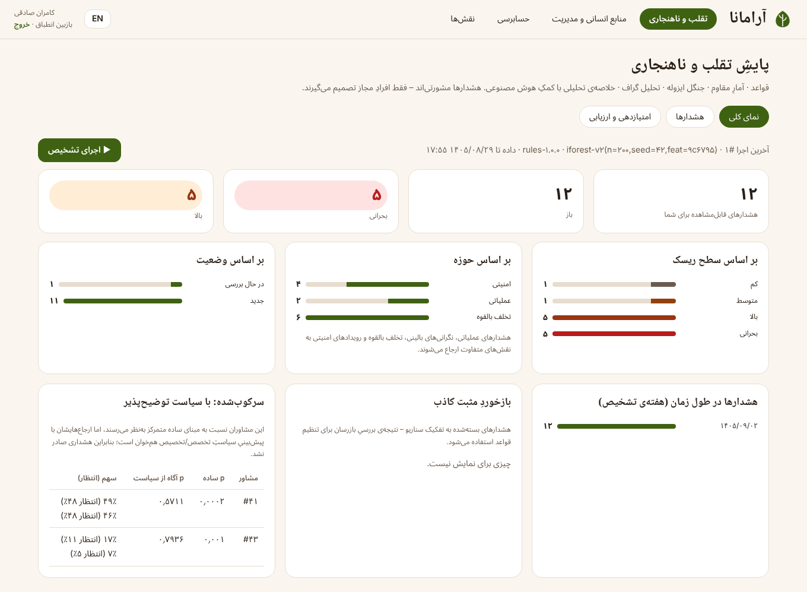
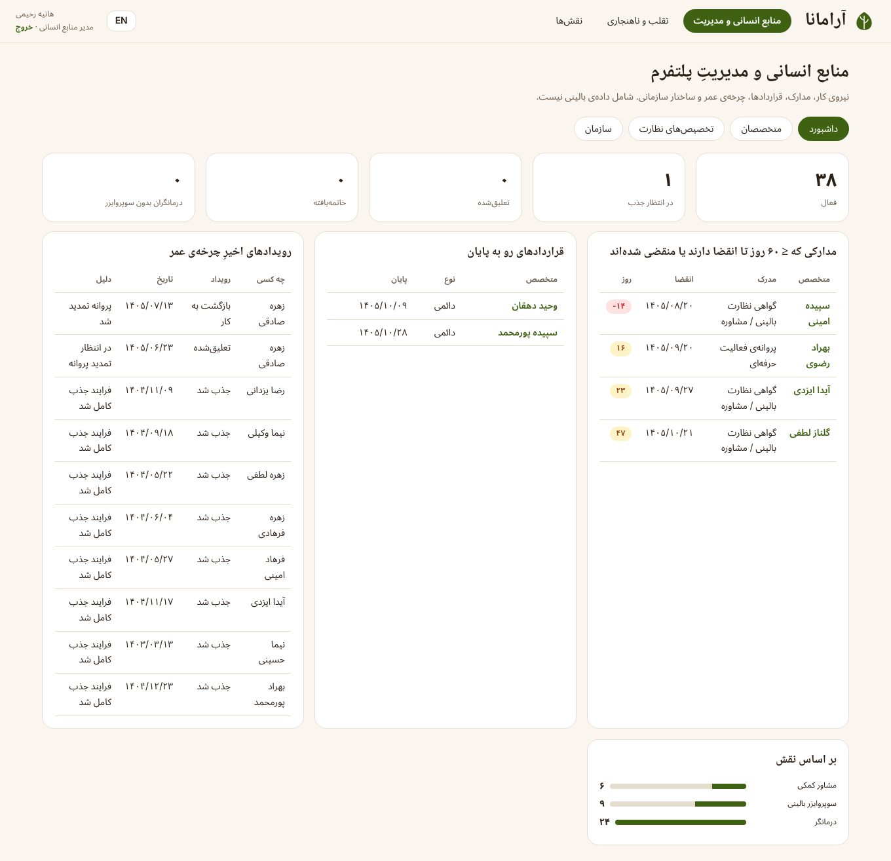
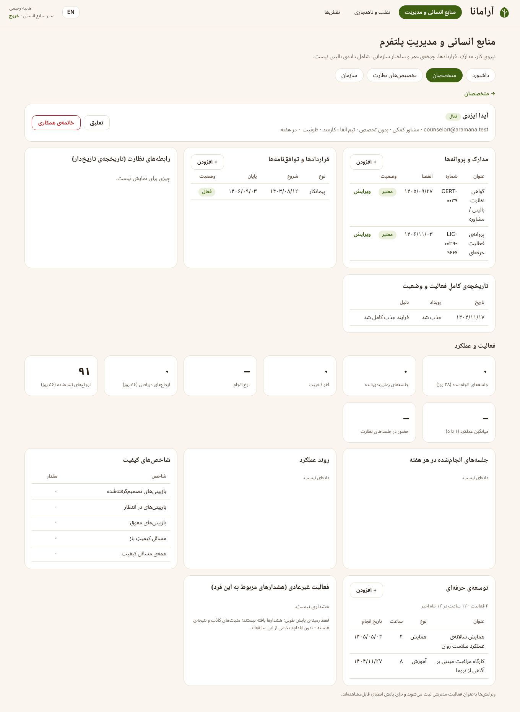

# آرامانا (ARAMANA) – حاکمیت نیروی کار، نظارت بالینی و تشخیص تقلب مبتنی بر هوش مصنوعی

[English](README.md) · **فارسی**

**بک‌اند Django + DRF · فرانت‌اند React (Vite)** · داده‌ی مصنوعی · بدون نیاز به API پولی یا کلید API.

سه ماژول روی **یک مدل داده‌ی مشترک**:

| ماژول | کار آن |
|---|---|
| **الف – منابع انسانی و مدیریت پلتفرم** | پروفایل متخصصان، مدارک و پروانه‌ها، قراردادها، گردش‌کار جذب ← تعلیق ← خاتمه‌ی همکاری، ساختار سازمانی، انتساب سوپروایزر با تاریخ اعتبار (effective-dated)، کنترل دسترسی نقش‌محور (RBAC) |
| **ب – نظارت بالینی** | داشبورد سوپروایزر، گردش‌کار بازبینی ← بازخورد ← اقدام اصلاحی ← بستن، مسائل کیفیت و ارجاع (escalation)، ردپای حسابرسی کامل |
| **ج – موتور تشخیص تقلب و ناهنجاری** | قواعد + آمار مقاوم + Isolation Forest + تحلیل گراف؛ امتیاز ریسک **قابل‌توضیح**؛ گردش‌کار تحقیق که فقط انسان در آن تصمیم می‌گیرد؛ **دستیار تحقیق LLM با محافظ‌ها** (ارجاع‌دار، مقید به شواهد، red-team‌شده – ر.ک. [docs/fa/LLM_ASSISTANT.md](docs/fa/LLM_ASSISTANT.md)) |

> **می‌خواهید نصب و اجرا کنید؟ [docs/fa/GUIDE.md](docs/fa/GUIDE.md) را دنبال کنید.** **تازه‌وارد هستید؟ اول [docs/fa/UNDERSTANDING.md](docs/fa/UNDERSTANDING.md) را بخوانید** – تور راهنما: مفاهیم، مسیر یک درخواست، الگوهای طراحی، SOLID/DRY با ارجاع به فایل‌ها، و راهنمای توسعه.

---

## شروع سریع (حدود ۳ دقیقه)

پیش‌نیازها: **Python 3.11+** و **Node.js ‏20.19+ یا 22+** (Vite 8 روی Node قدیمی‌تر اجرا نمی‌شود). نه سرور پایگاه‌داده لازم است و نه Docker.

```bash
git clone https://github.com/samahalati/AramanaChallenge.git && cd AramanaChallenge

# ۱) بک‌اند
python3 -m venv .venv && source .venv/bin/activate        # ویندوز: .venv\Scripts\activate
pip install -r backend/requirements.txt
cd backend
cp .env.example .env                                       # اختیاری – مقادیر پیش‌فرض کار می‌کنند
python manage.py migrate
python manage.py seed_demo --detect                        # داده‌ی مصنوعی + اولین اجرای تشخیص
python manage.py runserver 0.0.0.0:8000                    # API ← http://localhost:8000/api/docs/
```

```bash
# ۲) فرانت‌اند (ترمینال دوم)
cd frontend
npm install
npm run dev                                                # ← http://localhost:5173  (درخواست‌های /api را به :8000 پراکسی می‌کند)
```

**روش تک‌فرایندی:** `cd frontend && npm run build` – سپس Django خودش اپ ساخته‌شده‌ی React را روی **http://localhost:8000** سرو می‌کند.
میان‌بُرها: `make install seed backend frontend build test eval reset`. Docker: `docker build -t aramana . && docker run -p 8000:8000 aramana`.

### حساب‌های دمو (رمز همه: `Demo!2345`)

| حساب | نقش | چه کار کنید |
|---|---|---|
| `compliance@aramana.test` | بازبین انطباق (Compliance) | **Fraud & Anomaly** ← Alerts ← یک هشدار را باز کنید؛ تشخیص را اجرا کنید؛ تحقیق کنید |
| `hr@aramana.test` | مدیر منابع انسانی | متخصصان، مدارک، تعلیق/بازگشت، تغییر سوپروایزر |
| `supervisor1@aramana.test` | سوپروایزر بالینی | داشبورد، بازبینی‌ها، اقدام اصلاحی، ارجاع |
| `admin@aramana.test` | مدیر پلتفرم | حساب‌ها؛ `/hr` را امتحان کنید ← «در دسترس نیست»؛ خواندن داده‌ی بالینی با API ← ۴۰۳ + هشدار امنیتی |
| `admin2@aramana.test` | مدیر پلتفرم (متخلف) | موضوع یک هشدار **بحرانی** از پیش‌ساخته (سناریوی ۴) |
| `hr2@aramana.test` | مدیر منابع انسانی (انفجار ویرایش) | موضوع یک هشدار از پیش‌ساخته |
| `therapist1@aramana.test` | درمانگر | زمان‌بندی جلسه (جلسات هم‌پوشان را امتحان کنید)، دیدن بازخوردها |
| `counselor1@aramana.test` | مشاور کمکی | ایجاد ارجاع |

### چهار سناریوی الزامی (از پیش ساخته؛ بلافاصله بعد از `--detect` دیده می‌شوند)

1. **فعالیت مشکوک جلسات** – *Overlapping session records…* (۱۵ جفت، ۴ مورد از نظر فیزیکی ناممکن). *زنده:* با `therapist1` دو جلسه‌ی هم‌پوشان زمان‌بندی کنید ← با `compliance` روی **Run detection now** بزنید.
2. **شبکه‌ی ارجاع غیرعادی** – *Abnormal referral concentration…*؛ در Overview بخش **«Suppressed: explained by policy»** مشاورِ واحد تخصصی را نشان می‌دهد که عمداً *هشدار نگرفت*.
3. **تأییدهای غیرعادی سوپروایزر** – *Unusual approval pattern…* (۵۸ تأیید از ۸۷ تأیید اخیر زیر ۳ دقیقه، ۲۲ مورد بدون مستندات). سوپروایزری که حجم بالای *مشروع* دارد در سطح **Low** می‌ماند.
4. **فعالیت غیرمجاز مدیریتی** – *Administrative account activity outside permission scope* (بحرانی). *زنده:*
   ```bash
   TOKEN=$(curl -s localhost:8000/api/auth/login -H 'content-type: application/json' \
     -d '{"email":"admin@aramana.test","password":"Demo!2345"}' | python -c 'import sys,json;print(json.load(sys.stdin)["access_token"])')
   for i in 1 2 3 4 5; do curl -s -o /dev/null -w "%{http_code} " -H "Authorization: Bearer $TOKEN" localhost:8000/api/clinical/practitioners/15/sessions; done   # ۴۰۳ × ۵
   ```
   سپس با `compliance` ← **Run detection now** ← یک هشدار امنیتی تازه برای `admin@aramana.test` ظاهر می‌شود (Medium: ۵ تلاش مسدودشده).

به‌علاوه: یک سناریوی فقط‌گراف (خوشه‌ی انحصاری ارجاع/تأیید)، انفجار ویرایش مدیر HR، حمله‌ی brute force و credential stuffing.

---

## تصاویر (رابط فارسی، طراحی «خاک و زیتون»)
| | |
|---|---|
|  |  |
|  |  |

صفحه‌ی کامل هشدار با گردش‌کار تحقیق، شواهد و دستیار هوش مصنوعی: [docs/screenshots/alert-detail.png](docs/screenshots/alert-detail.png).

## زبان
رابط کاربری، متن هشدارها، خطاهای API، داده‌ی دمو و دستیار LLM **به‌طور پیش‌فرض فارسی‌اند (راست‌به‌چپ، تاریخ جلالی)** و در سربرگ یک **کلید EN/فا** وجود دارد. سند رسمی چالش انگلیسی است و الزامی برای زبان ندارد؛ به همین دلیل هر دو پشتیبانی می‌شوند. داده‌ی انگلیسی: `python manage.py seed_demo --reset --detect --lang en`. جزئیات و محدودیت‌ها: [docs/fa/I18N.md](docs/fa/I18N.md).

## API هوش مصنوعیِ رایگان و دستیار تحقیق LLM (اختیاری)

روی هر هشدار، بازبین‌ها یک **دستیار با محافظ** دارند: خلاصه‌ی ساختاریافته و پرسش‌وپاسخِ مبتنی بر شواهد که منابعش را ارجاع می‌دهد (چیپ‌های قابل‌کلیک)، پرسش‌های تصمیم‌خواه/شناسایی را رد می‌کند، هر پاسخ را با ۶ محافظ اعتبارسنجی می‌کند (schema · citations · numbers · tone · identity · consistency) و اگر مدل شکست بخورد یا ردشود به پاسخ قطعی برمی‌گردد. همه‌چیز بدون اینترنت هم کار می‌کند (حالت قطعی). طراحی، مدل تهدید، ارزیابی و محدودیت‌ها: **[docs/fa/LLM_ASSISTANT.md](docs/fa/LLM_ASSISTANT.md)**. برای مدل زبانی واقعی **به‌صورت رایگان**، در `backend/.env` تنظیم کنید:

| ارائه‌دهنده | سطح رایگان | تنظیمات |
|---|---|---|
| Google Gemini | کلید AI Studio – <https://aistudio.google.com/apikey> | `LLM_PROVIDER=gemini`، `LLM_API_KEY=…` |
| Groq | کلید رایگان – <https://console.groq.com/keys> | `LLM_PROVIDER=groq`، `LLM_API_KEY=…` |
| Ollama | محلی، بدون کلید | `LLM_PROVIDER=ollama` (بعد از `ollama pull llama3.2`) |

مدل زبانی فقط شواهدِ **شبه‌ناشناس و پاک‌سازی‌شده** را می‌بیند؛ هرگز امتیاز نمی‌دهد، تصمیم نمی‌گیرد و مسیر نوشتن ندارد. `python manage.py evaluate_llm` محافظ‌ها را red-team می‌کند (۷۲۸ بررسی، ۱۰۰٪ ایمن – برای اینکه این عدد چه چیزی را ثابت می‌کند به سند مراجعه کنید). *با سطح رایگان Gemini به‌صورت نقطه‌ای آزمایش شده (جزئیات و محدودیت‌ها در سند)؛ نگهبان‌های معنایی به مدل قاضی وابسته‌اند، پس پیش از اتکا با کلید خودتان بسنجید.*

---

## ساختار مخزن

```
backend/                         پروژه‌ی Django
  config/                        تنظیمات (12-factor، مبتنی بر متغیر محیطی)، urls، wsgi
  core/                          هسته‌ی مشترک: rbac، permissions، auth، زنجیره‌ی حسابرسی، ماشین حالت، خطاها، ثابت‌ها
  accounts/                      مدل User، ورود (با قفل حساب)، مدیریت حساب‌ها
  hr/                            ماژول الف: پروفایل‌ها، مدارک، قراردادها، چرخه‌ی حیات، انتساب‌ها
  clinical/                      جلسات و ارجاع‌ها (مراجعِ شبه‌ناشناس)
  supervision/                   ماژول ب: بازبینی‌ها، اقدام‌های اصلاحی، مسائل کیفیت، جلسات نظارت
  monitoring/                    ماژول ج: هشدارها، گردش‌کار تحقیق، اجراها، ارزیابی، سیاست دید (visibility)
  detection/                     موتور پایتون خالص: آشکارسازهای Strategy، امتیازدهی، توضیح، آداپتور LLM، config.yaml
  seed/                          داده‌ی مصنوعی + ناهنجاری‌های تزریقی + ground truth
  tests/                         pytest-django (۹۱ تست)
frontend/                        React + Vite (TanStack Query، React Router)
  src/{api,auth,components,features}   e2e/smoke.cjs (Playwright)
docs/                            UNDERSTANDING · ENGINEERING_RULES · HOWTO · ARCHITECTURE · TECHNICAL_REPORT · DATASET · LLM_ASSISTANT · I18N · PRESENTATION · RBAC_MATRIX · openapi.yaml · PLAN
docs/fa/                         نسخه‌ی فارسی مستندات
```

## دستورها

```bash
cd backend
python manage.py migrate                         # ساخت/به‌روزرسانی schema (مهاجرت‌های Django)
python manage.py seed_demo [--reset] [--detect] [--seed-value N]
python manage.py run_detection                   # idempotent؛ با هشدارهای موجود deduplicate می‌کند
python manage.py evaluate                        # precision/recall/F1 + ablation نسبت به ground truth مصنوعی
python manage.py export_docs                     # بازتولید docs/RBAC_MATRIX.md و docs/openapi.yaml از روی کد
python manage.py evaluate_llm [--live]           # red-team محافظ‌های LLM (مدل اسکریپت‌شده، بدون شبکه؛ --live با کلید شما)
python -m pytest -q                              # ۹۱ تست
python scripts/multi_seed_eval.py 1 2 3 4 5 6 7 8   # پایداری در دنیاهای مصنوعی مختلف
cd ../frontend && BASE=http://localhost:5173 node e2e/smoke.cjs   # تست دود مرورگر (به Playwright نیاز دارد)
```

پیکربندی: `backend/.env.example` (`DATABASE_URL` — پیش‌فرض SQLite، برای PostgreSQL از `postgres://…` و `psycopg` استفاده کنید؛ `SECRET_KEY` — **حتماً عوض کنید**؛ تنظیمات توکن/قفل حساب؛ `LLM_*`). وزن‌ها و آستانه‌های تشخیص: `backend/detection/config.yaml` (نسخه‌دار).

## فهرست مستندات

| خروجی | فایل |
|---|---|
| **راهنمای کامل: نصب، اجرا، پیکربندی، کارکرد همه‌چیز، عیب‌یابی** | [docs/fa/GUIDE.md](docs/fa/GUIDE.md) |
| **ردیابی الزام‌ها: هر بند سند اصلی ← کد، رابط، آزمون** | [docs/fa/REQUIREMENTS_TRACEABILITY.md](docs/fa/REQUIREMENTS_TRACEABILITY.md) |
| فهم پروژه، الگوهای طراحی، SOLID/DRY، راهنمای توسعه | [docs/fa/UNDERSTANDING.md](docs/fa/UNDERSTANDING.md) |
| طراحی بصری (پالت، فونت، نشانک) | [docs/fa/DESIGN.md](docs/fa/DESIGN.md) |
| قواعد مهندسی و راهنمای گام‌به‌گام (افزودن آشکارساز، تغییر RBAC، ارزیابی…) | [docs/fa/ENGINEERING_RULES.md](docs/fa/ENGINEERING_RULES.md) · [docs/fa/HOWTO.md](docs/fa/HOWTO.md) |
| الف. معماری (سیستم، ماژول‌ها، ERD، جریان داده، معماری تشخیص تقلب، امنیت، مقیاس‌پذیری) | [docs/fa/ARCHITECTURE.md](docs/fa/ARCHITECTURE.md) · [ماتریس RBAC](docs/RBAC_MATRIX.md) · [OpenAPI](docs/openapi.yaml) |
| د. گزارش فنی (تصمیم‌ها، روش‌شناسی، نتایج اندازه‌گیری‌شده، محدودیت‌ها، هزینه، نقشه‌راه) | [docs/fa/TECHNICAL_REPORT.md](docs/fa/TECHNICAL_REPORT.md) |
| ه. ارائه (سازگار با Marp) | [docs/fa/PRESENTATION.md](docs/fa/PRESENTATION.md) |
| داده، فرضیات، محدودیت‌ها | [docs/fa/DATASET.md](docs/fa/DATASET.md) |
| دستیار LLM: محافظ‌ها، مدل تهدید، ارزیابی | [docs/fa/LLM_ASSISTANT.md](docs/fa/LLM_ASSISTANT.md) |

## محدودیت‌های شناخته‌شده (خلاصه – فهرست کامل در گزارش)

* ناهنجاری‌های مصنوعیِ نوشته‌شده توسط خودِ سازنده ⇒ معیارها خوش‌بینانه‌اند (میانگین ۸ دانه: precision ‏۰٫۹۸ / recall ‏۱٫۰۰).
* احراز هویت در حد دمو (رمز محلی، JWT از نوع HS256 در `sessionStorage`؛ بدون MFA/SSO/refresh)؛ TLS باید توسط پروکسی تأمین شود.
* پیش‌فرض SQLite؛ فیلتر دید هشدارها در پایتون انجام می‌شود (برای نمونه‌ی اولیه کافی است، در مقیاس بزرگ به محدودسازی در سطح SQL نیاز دارد)؛ تشخیص به‌صورت دسته‌ای/درخواستی است.
* OpenAPI تولیدشده در سطح مسیر است (viewها بر پایه‌ی APIView هستند و شِمای درخواست/پاسخ عمدتاً توصیف نشده)؛ مرجع اعتبارسنجی همان serializerهای DRF هستند.
* پایش **جلوی** عملیات را نمی‌گیرد (هم‌پوشانی‌ها/تأییدهای بدون مستندات پذیرفته و سپس علامت‌گذاری می‌شوند) – انتخابی آگاهانه در سیاست‌گذاری.
