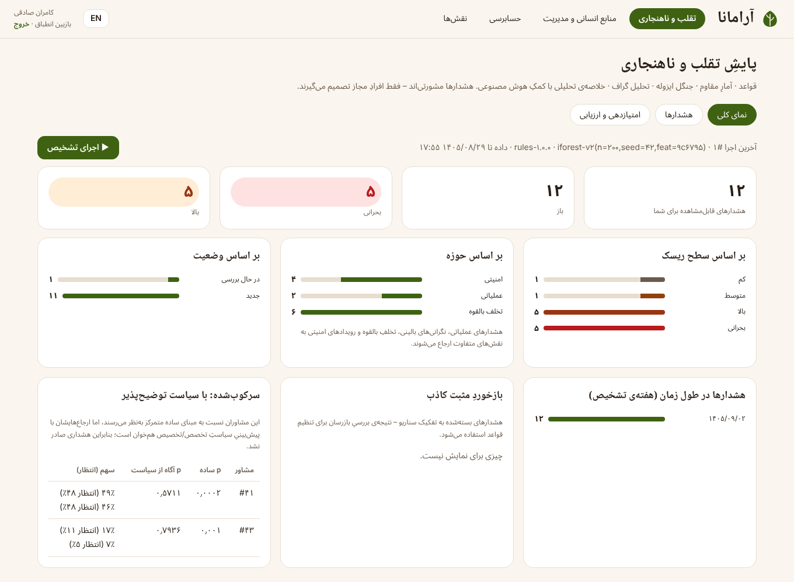
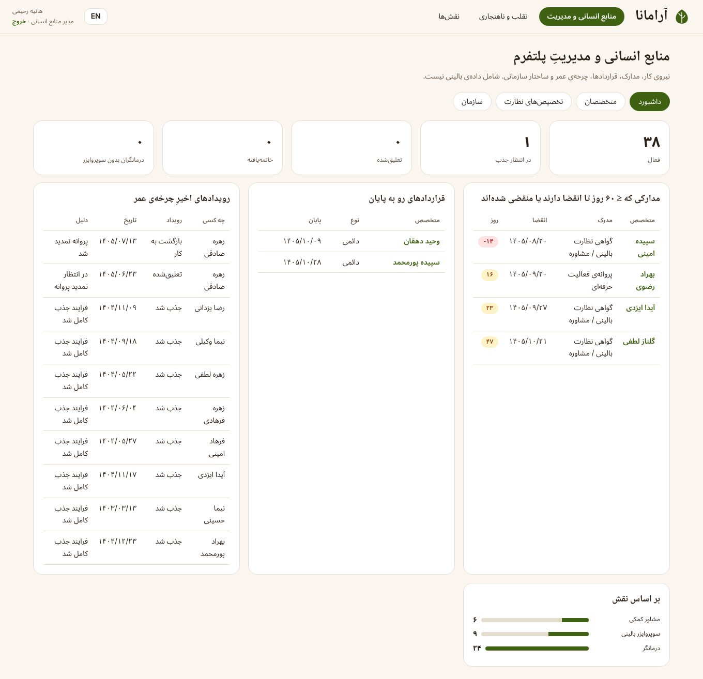
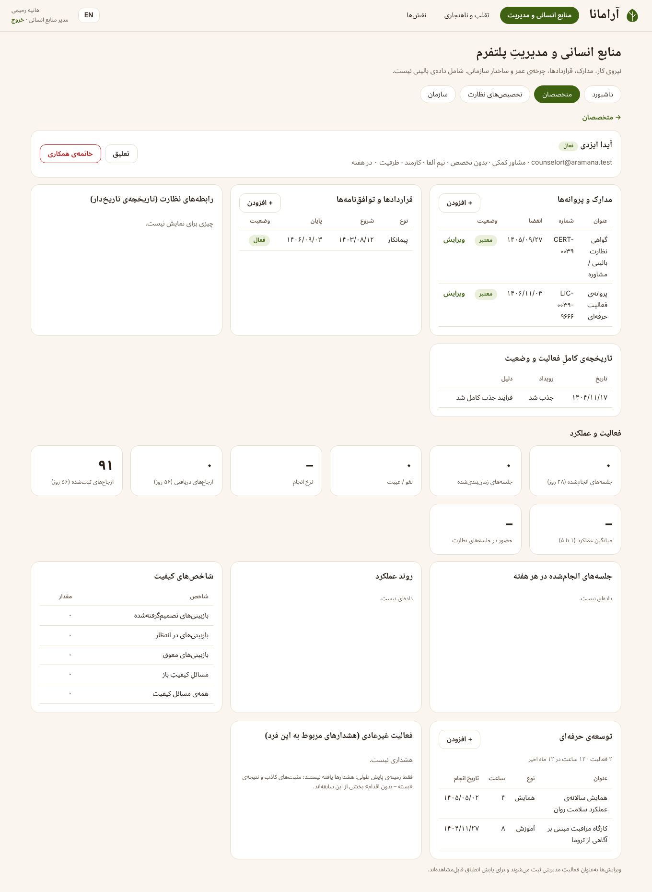

# ARAMANA – Workforce Governance, Clinical Supervision & AI-Powered Fraud Detection

**English** · [فارسی](README.fa.md)

**Django + DRF backend · React (Vite) frontend** · synthetic data · no paid API, no API key required.

Three modules on one shared data model:

| Module | What it does |
|---|---|
| **A – HR & Platform Admin** | profiles, credentials, contracts, onboarding → suspension → termination, org structure, effective-dated supervisor assignments, RBAC |
| **B – Clinical Supervision** | supervisor dashboard, review → feedback → corrective action → close, quality issues & escalation, full audit |
| **C – Fraud & Anomaly Engine** | rules + robust statistics + Isolation Forest + graph analysis; explainable risk scores; human-only investigation workflow; **guarded LLM investigation assistant** (cited, evidence-bound, red-teamed – see [docs/LLM_ASSISTANT.md](docs/LLM_ASSISTANT.md)) |

> **Installing or running it? Follow [docs/GUIDE.md](docs/GUIDE.md).** **New here? Read [docs/UNDERSTANDING.md](docs/UNDERSTANDING.md)** – the guided tour: concepts, request flow, design patterns, SOLID/DRY with file references, how to extend.

---

## Quick start (≈ 3 minutes)

Requirements: **Python 3.11+** and **Node.js 20.19+ or 22+** (Vite 8 does not run on older Node). No database server, no Docker needed.

```bash
git clone https://github.com/samahalati/AramanaChallenge.git && cd AramanaChallenge

# 1) Backend
python3 -m venv .venv && source .venv/bin/activate        # Windows: .venv\Scripts\activate
pip install -r backend/requirements.txt
cd backend
cp .env.example .env                                       # optional – defaults work; loaded automatically
python manage.py migrate
python manage.py seed_demo --detect                        # synthetic data + first detection run
python manage.py runserver 0.0.0.0:8000                    # API → http://localhost:8000/api/docs/
```

```bash
# 2) Frontend (second terminal)
cd frontend
npm install
npm run dev                                                # → http://localhost:5173  (proxies /api to :8000)
```

**Single-process alternative:** `cd frontend && npm run build` – Django then serves the built React app itself at **http://localhost:8000**.
Shortcuts: `make install seed backend frontend build test eval reset`. Docker: `docker build -t aramana . && docker run -p 8000:8000 aramana`.

### Demo accounts (password for all: `Demo!2345`)

| Account | Role | Try this |
|---|---|---|
| `compliance@aramana.test` | Compliance reviewer | **Fraud & Anomaly** → Alerts → open one; run detection; investigate |
| `hr@aramana.test` | HR administrator | practitioners, credentials, suspend/reactivate, reassign supervisors |
| `supervisor1@aramana.test` | Clinical supervisor | dashboard, reviews, corrective actions, escalate |
| `admin@aramana.test` | Platform admin | accounts; try `/hr` → "not available"; read clinical data via API → 403 + security alert |
| `admin2@aramana.test` | Platform admin (rogue) | subject of a pre-seeded **critical** alert (scenario 4) |
| `hr2@aramana.test` | HR admin (edit burst) | subject of a pre-seeded alert |
| `therapist1@aramana.test` | Therapist | schedule sessions (try overlapping ones), see feedback |
| `counselor1@aramana.test` | Assistant counselor | create referrals |

### The four required scenarios (pre-seeded; visible right after `--detect`)

1. **Suspicious session activity** – *Overlapping session records…* (15 pairs, 4 physically impossible). *Live:* as `therapist1` schedule two overlapping sessions → as `compliance` press **Run detection now**.
2. **Abnormal referral network** – *Abnormal referral concentration…*; Overview → **"Suppressed: explained by policy"** shows the specialisation-unit counselor that was deliberately *not* alerted.
3. **Unusual supervisor approvals** – *Unusual approval pattern…* (58 of 87 recent approvals under 3 min, 22 undocumented). A supervisor with legitimate high volume stays **Low**.
4. **Unauthorized administrative activity** – *Administrative account activity outside permission scope* (critical). *Live:*
   ```bash
   TOKEN=$(curl -s localhost:8000/api/auth/login -H 'content-type: application/json' \
     -d '{"email":"admin@aramana.test","password":"Demo!2345"}' | python -c 'import sys,json;print(json.load(sys.stdin)["access_token"])')
   for i in 1 2 3 4 5; do curl -s -o /dev/null -w "%{http_code} " -H "Authorization: Bearer $TOKEN" localhost:8000/api/clinical/practitioners/15/sessions; done   # 403 ×5
   ```
   then as `compliance` → **Run detection now** → a new security alert for `admin@aramana.test` (Medium: 5 blocked probes).

Plus a graph-only scenario (exclusive referral/approval cluster), HR edit burst, brute force and credential stuffing.

---

## Screenshots (Persian UI, "Earth & Olive" design)
| | |
|---|---|
|  |  |
|  |  |

Full alert page with the investigation workflow, evidence and AI assistant: [docs/screenshots/alert-detail.png](docs/screenshots/alert-detail.png).

## Language
The UI, alert text, API errors, demo data and LLM assistant are **Persian by default (RTL, Jalali dates)** with an **EN/فا switch** in the header. The official brief is in English and sets no language requirement, so both are supported. English dataset: `python manage.py seed_demo --reset --detect --lang en`. Details and limits: [docs/I18N.md](docs/I18N.md).

## Free AI API & the LLM investigation assistant (optional)

On every alert, reviewers get a **guarded assistant**: a structured briefing and grounded Q&A that cites its sources (clickable chips), refuses decision-seeking/identity questions, validates every reply with 6 guardrails (schema · citations · numbers · identity checked deterministically, tone · consistency by an LLM judge), and falls back to a deterministic answer if the model fails or is rejected. Everything works offline (deterministic mode). Design, threat model, evaluation and limits: **[docs/LLM_ASSISTANT.md](docs/LLM_ASSISTANT.md)**. For a real LLM **for free**, set in `backend/.env`:

| Provider | Free tier | Settings |
|---|---|---|
| Google Gemini | AI Studio key – <https://aistudio.google.com/apikey> | `LLM_PROVIDER=gemini`, `LLM_API_KEY=…` |
| Groq | free key – <https://console.groq.com/keys> | `LLM_PROVIDER=groq`, `LLM_API_KEY=…` |
| Ollama | local, no key | `LLM_PROVIDER=ollama` (after `ollama pull llama3.2`) |

The LLM only sees **pseudonymised, sanitised** evidence; it never scores or decides and has no write path. `python manage.py evaluate_llm` red-teams the guardrails (728 deterministic checks, English + Persian, 100 % safe; `--live` measures the real model/judge – see the doc for how much that number proves). *Spot-checked with Gemini's free tier (details and honest limits in the doc); semantic guardrails depend on the judge model, so measure with your own key before relying on them.*

---

## Repository layout

```
backend/                         Django project
  config/                        settings (12-factor, env-driven), urls, wsgi
  core/                          shared kernel: rbac, permissions, auth, audit chain, state machine, errors, constants
  accounts/                      User model, login (lockout), account administration
  hr/                            Module A: profiles, credentials, contracts, lifecycle, assignments
  clinical/                      sessions & referrals (pseudonymous clients)
  supervision/                   Module B: reviews, corrective actions, quality issues, meetings
  monitoring/                    Module C: alerts, investigation workflow, runs, evaluation, visibility policy
  detection/                     PURE PYTHON engine: Strategy detectors, scoring, explain, config.yaml, llm.py (transport) + assistant/ (guarded LLM)
  seed/                          synthetic data + injected anomalies + ground truth
  tests/                         pytest-django (93 tests)
frontend/                        React + Vite (TanStack Query, React Router)
  src/{api,auth,components,features}   e2e/smoke.cjs (Playwright)
docs/                            UNDERSTANDING · ENGINEERING_RULES · HOWTO · ARCHITECTURE · TECHNICAL_REPORT · DATASET · LLM_ASSISTANT · I18N · PRESENTATION · RBAC_MATRIX · openapi.yaml · PLAN
docs/fa/                         Persian versions of the documents
```

## Commands

```bash
cd backend
python manage.py migrate                         # create/upgrade schema (Django migrations)
python manage.py seed_demo [--reset] [--detect] [--seed-value N]
python manage.py run_detection                   # idempotent; de-duplicates against existing alerts
python manage.py evaluate                        # precision/recall/F1 + ablation vs synthetic ground truth
python manage.py export_docs                     # regenerate docs/RBAC_MATRIX.md + docs/openapi.yaml from code
python manage.py evaluate_llm [--live]           # red-team the LLM guardrails (scripted model, no network; --live uses your key)
python -m pytest -q                              # 93 tests
python scripts/multi_seed_eval.py 1 2 3 4 5 6 7 8   # robustness across synthetic worlds
cd ../frontend && BASE=http://localhost:5173 node e2e/smoke.cjs   # browser smoke test (needs Playwright)
```

Configuration: `backend/.env.example` (DATABASE_URL — SQLite default, PostgreSQL via `postgres://…` + `psycopg`; `SECRET_KEY` — **change it**; token/lockout settings; `LLM_*`). Detection weights/thresholds: `backend/detection/config.yaml` (versioned).

## Documentation index

| Deliverable | File |
|---|---|
| **Complete guide: install, run, configure, how everything works, troubleshooting** | [docs/GUIDE.md](docs/GUIDE.md) |
| **Requirements traceability: every clause of the original brief → code, UI, test** | [docs/REQUIREMENTS_TRACEABILITY.md](docs/REQUIREMENTS_TRACEABILITY.md) |
| Understanding, patterns, SOLID/DRY, extension guide | [docs/UNDERSTANDING.md](docs/UNDERSTANDING.md) |
| Visual design (palette, fonts, logo) | [docs/DESIGN.md](docs/DESIGN.md) |
| Engineering rules and how-to playbooks (add a detector, change RBAC, evaluate…) | [docs/ENGINEERING_RULES.md](docs/ENGINEERING_RULES.md) · [docs/HOWTO.md](docs/HOWTO.md) |
| Persian/English support (design, limits) | [docs/I18N.md](docs/I18N.md) |
| A. Architecture (system, modules, ERD, data flow, fraud architecture, security, scalability) | [docs/ARCHITECTURE.md](docs/ARCHITECTURE.md) · [RBAC matrix](docs/RBAC_MATRIX.md) · [OpenAPI](docs/openapi.yaml) |
| D. Technical report (decisions, methodology, measured results, limitations, cost, roadmap) | [docs/TECHNICAL_REPORT.md](docs/TECHNICAL_REPORT.md) |
| E. Presentation (Marp-compatible) | [docs/PRESENTATION.md](docs/PRESENTATION.md) |
| Dataset, assumptions, limitations | [docs/DATASET.md](docs/DATASET.md) |
| LLM assistant: guardrails, threat model, evaluation | [docs/LLM_ASSISTANT.md](docs/LLM_ASSISTANT.md) |

## Known limitations (summary – full list in the report)

* Synthetic, self-authored anomalies ⇒ optimistic metrics (8-seed mean precision 0.98 / recall 1.00).
* Demo-grade auth (local passwords, HS256 JWT in `sessionStorage`; no MFA/SSO/refresh); TLS must be terminated by a proxy.
* SQLite default; alert visibility is filtered in Python (fine for a prototype, needs SQL-level scoping at scale); detection is batch/on-demand.
* The generated OpenAPI is path-level (views are APIView-based, so request/response schemas are largely not described); the DRF serializers are the validation source of truth.
* Monitoring does **not block** actions (overlaps/undocumented approvals are accepted, then flagged) – a deliberate policy choice.
