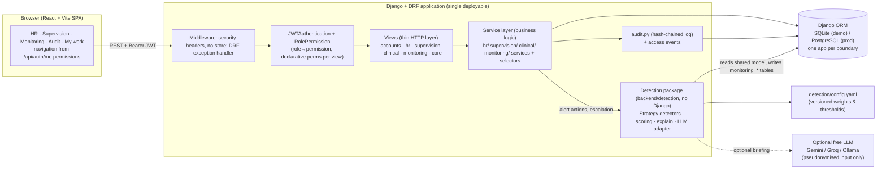
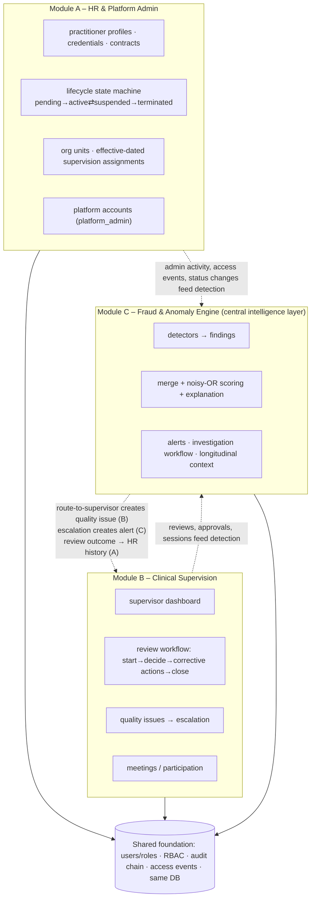
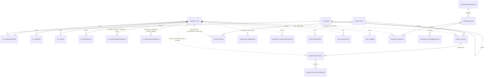
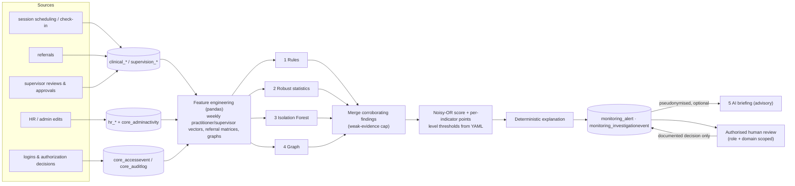
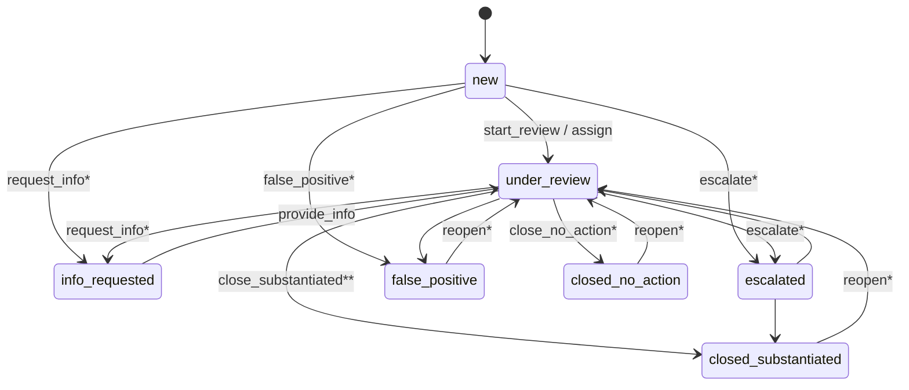

# Architecture & Design

**English** · [فارسی](fa/ARCHITECTURE.md)

All diagrams are Mermaid (rendered natively by GitHub / VS Code). Companion files: [UNDERSTANDING.md](UNDERSTANDING.md) (start here), [RBAC_MATRIX.md](RBAC_MATRIX.md), [openapi.yaml](openapi.yaml) / live `/api/docs/`, [DATASET.md](DATASET.md), [TECHNICAL_REPORT.md](TECHNICAL_REPORT.md).

## 1. System architecture

**Why one deployable?** The brief asks for a prototype that three modules share on one coherent data model. A modular monolith (one Django app per boundary, one DB) delivers that with the least moving parts; boundaries are drawn so each package can be split out later (see §9).

## 2. Module & service architecture

**Integration points implemented (not just described):**

| Flow | Mechanism |
|---|---|
| Unusual practitioner activity → alert | `clinical_session` / `supervision_review` / `clinical_referral` → engine → `monitoring_alert` |
| HR / compliance examines the alert | `GET /alerts/{id}` (role-scoped, client refs redacted) |
| Quality concern → right supervisor | `POST /alerts/{id}/route-to-supervisor` → `supervision_qualityissue` for the *current* supervisor (never when the supervisor is part of the alert) |
| Supervisor outcome → operational record | `decide_review` writes a summary `hr_lifecycleevent(supervision_review)` – no clinical content crosses the boundary |
| Supervisor escalation → monitoring | `escalate_issue` creates an `monitoring_alert` row (category Q, manual indicator) |
| Repeated anomalies → longitudinal monitoring without presumption | `GET /monitoring/users/{id}/history` – context only; never alters scores or statuses |

## 3. Database design

21 tables; **boundaries are Django apps** (`accounts`+`hr` identity/workforce, `clinical`+`supervision` care operations, `core` security, `monitoring` AI output). Cross-boundary references to people are **plain integer IDs, not foreign keys** (clients are pseudonyms), which is what lets the clinical tables be moved to their own database/cluster with separate credentials (see §9).

Key columns (full definitions: each app's `models.py`; migrations: each app's `migrations/`):

| Table | Notes |
|---|---|
| `accounts_user` | role, status (`pending_onboarding/active/suspended/terminated`), lockout counters; PBKDF2 hash |
| `hr_supervisionassignment` | `effective_from/effective_to` – **history is never overwritten**; index `(supervisee_id, effective_to)` finds the current one |
| `hr_professionaldevelopment` | professional development activities (kind, title, provider, hours, date) – feeds the HR activity & performance view (`hr/activity.py`, spec §3.3) |
| `hr_lifecycleevent` | the "complete activity & status history" (onboarding, suspension, reassignment, review outcome summaries) |
| `clinical_session` | scheduled vs reported vs verified (`checkin_at/checkout_at`), `modification_count`, `group_id` (legit group sessions), `mode/location_code` |
| `supervision_review` | `decision_minutes`, `has_documentation` (the approval-behaviour features), `closed_at` |
| `core_auditlog` | `prev_hash`/`hash` chain; `GET /api/audit/verify` re-computes it |
| `core_accessevent` | login ok/failed, access allowed/denied with permission + path + IP |
| `monitoring_alert` | score, level, `methods[]`, `score_breakdown` (JSON, points sum to score), `evidence`, `record_refs`, `ruleset_version`, `model_version`, `dedup_key` |

**Indexing** (all on hot paths): `clinical_session(practitioner_id, scheduled_start)`, `clinical_referral(from_user_id)`, `clinical_referral(to_practitioner_id)`, `supervision_review(supervisor_id|supervisee_id|decided_at)`, `core_accessevent(ts,user_id)`, `core_auditlog(ts,actor_id)`, `monitoring_alert(status, risk_level, category, domain, subject_user_id, dedup_key, detected_at)`.

**Data ownership boundaries**

| App (tables) | Owner | Who may read |
|---|---|---|
| `accounts_*`, `hr_*` | HR administration | hr_admin (rw), compliance (ro), supervisors (own supervisees' *summary* only) |
| `clinical_*`, `supervision_*` | Clinical operations | therapist (own), supervisor (current supervisees), compliance (alerted users). **Never** hr_admin / platform_admin |
| `core_*` | Security & audit | compliance, platform_admin (audit:read) |
| `monitoring_*` | Compliance & monitoring | role→domain visibility, never the subject |

**Audit history & retention.** Audit/access/alert/investigation rows are append-only (the API exposes no update/delete). Suggested retention for production (policy decision, not enforced in the prototype): audit & investigation 7 years; access events 24 months; raw behavioural features 13 months rolling; clinical session metadata per clinical-records law; alerts closed as false-positive 24 months (needed for tuning). Pseudonymous client refs allow erasure of the mapping table without breaking aggregates.

## 4. Data flow

## 5. Fraud-detection architecture (technique → why)

| # | Layer | Used for | Why this technique |
|---|---|---|---|
| 1 | **Rules** | overlapping/impossible sessions (interval sweep), reported-vs-checked duration, approvals without documentation / <3 min reviews, denied-access bursts, failed-login bursts, account-creation bursts, privilege grants, edit bursts | Logical impossibilities and policy violations need no statistics; precise, cheap, 100 % explainable, no labels required |
| 2 | **Robust statistics** | referral concentration (policy-aware Monte-Carlo goodness-of-fit + JS distance + naive-baseline comparison); **change of referral behaviour** over time (permutation test on the Jensen–Shannon distance between the previous and the recent period); peer outliers (median/MAD z-scores) | Small counts per practitioner ⇒ asymptotic chi-square is unreliable, so a simulated null is used; MAD is robust against the outliers being hunted; the policy-aware expectation separates specialisation from suspicious steering |
| 3 | **Isolation Forest** (per role cohort, practitioner-week vectors) | unknown unknowns: multivariate oddities no rule anticipates | Unsupervised (no labelled fraud history exists), mixed scales, fast. Always *explained* via robust-z driver features; unexplainable flags are dropped; weak weight; cannot alone exceed **Low** |
| 4 | **Graph** (networkx) | counselor→therapist referral edges + supervisor→therapist approval edges; flags therapists with **both** an exclusive referral dependency (policy-lift ≥2×) **and** an unconditional approval edge | Collusion is a *relationship* property – invisible to per-user tests. Justified only where relationships carry the signal |
| 5 | **AI-assisted investigation** | short advisory briefing of an alert (free LLM, or deterministic template offline) | LLM never scores or decides; input is pseudonymised structured evidence; output stored separately and labelled advisory |

**Risk scoring** (`backend/detection/scoring.py`, weights in `backend/detection/config.yaml`):

`score = 100 · (1 − Π(1 − wᵢ·sᵢ))` — each indicator has a weight `w` (max contribution) and a measured strength `s ∈ [0,1]`. Points are attributed sequentially so **Σ points = score exactly**; the UI shows the table. Levels: Low 0–34, Medium 35–59, High 60–79, Critical ≥80. **Corroboration rule:** alerts supported only by weak indicators (ML score, workload volume) are capped at Low – volume or an opaque model score alone never looks like a serious finding.

**False-positive management:** (a) policy-aware expectations & group-session handling remove known benign patterns; (b) *suppressed* candidates are listed with the reason; (c) a closed alert is not re-raised unless it contains **new** records (`record_refs`); (d) false-positive outcomes are aggregated per scenario (`/monitoring/summary`) for threshold tuning; (e) every alert lists benign explanations to rule out.

**Versioning:** `ruleset_version` (YAML), `model_version` (hash of features/params/seed), `config_hash` per detection run – stored on every alert and run ⇒ reproducible results.

## 6. Investigation workflow (state machine)

`*` documented note required (≥10 chars). `**` note ≥30 chars **and** the closing reviewer must have viewed the evidence (recorded as a `viewed` event). No transition has any side effect on a practitioner's status, role, contract or assignment – those are separate human HR actions (`POST /hr/.../lifecycle`). A test asserts the engine never modifies `accounts_user`.

## 7. Security & privacy design

| Concern | Implementation |
|---|---|
| Authentication | Django's PBKDF2-SHA256 hasher (per-user salt); JWT HS256 (60 min); uniform 401 (no account enumeration); lockout after 5 failures (returns 403); tokens of suspended users stop working immediately (user re-loaded per request) |
| Authorization / least privilege | Central `core/rbac.py` matrix + `core/permissions.py` + relationship scoping (`monitoring/visibility.py`, `hr/selectors.py`) (own / current supervisee / alerted subject). HR & platform admins hold **no** clinical permission. Denials are 403 **and** persisted (`core_accessevent` + audit) – this is the signal for scenario 4 |
| Conflict-of-interest guard | Nobody can see/assign/route an alert about themselves or in which they are a related user; a supervisor is never routed an alert in which they are involved; misconduct-domain alerts are never routed down to supervisors |
| Sensitive data protection | Client **pseudonyms** only; no free-text clinical narrative stored; `client_ref` redacted for roles w/o clinical access; HR views contain no clinical fields; therapist client list limited to their caseload |
| Data minimisation | LLM prompt contains no names/e-mails/client refs ("Practitioner #12"); features are aggregates; the supervisee overview returns session *counts*; the detailed session list (timing/status/pseudonym, no narrative) is relationship-scoped and audited |
| Audit logging | hash-chained (`/audit/verify` detects tampering – tested); logs *what was accessed* (field categories) not the data |
| Secure API communication | DRF serializer validation everywhere; bearer tokens; security headers (`nosniff`, `X-Frame-Options: DENY`, CSP, `no-store` on sensitive routes); TLS terminates at the reverse proxy (documented, not in-app) |
| Secrets | env only (`.env` git-ignored, `.env.example` provided); no secrets in code; secret key must be replaced (documented) |
| Common vulnerabilities | SQL injection: ORM/parameterised only; XSS: React escapes all rendered data (no `dangerouslySetInnerHTML`), CSP `default-src 'self'`; IDOR: every object access checks relationship; mass assignment: explicit request schemas; error leakage: generic 500 body, details to logs; privilege escalation: self role-change blocked & audited; brute force: lockout |
| Real data | none – synthetic generator only; demo password documented as demo-only |

## 8. API architecture

REST/JSON, resource-oriented, versionable by prefix; thin views → services → models. Errors: `400` validation, `404`, `409` conflict (illegal state transition / duplicate), `401/403` auth (lockout returns 403). OpenAPI generated: [openapi.yaml](openapi.yaml), live Swagger UI at `/api/docs/`. Pagination on list endpoints (`limit/offset`). Idempotent `POST /detection/run` (dedup by `dedup_key`).

## 9. Integration with the existing ARAMANA (Go) platform

* **Contract-first coupling.** The Go core talks to this service over its REST/OpenAPI contract (or events, below). No shared tables, no duplicated business logic: HR/supervision data is owned by the module; Go keeps authoritative *identity & client records*.
* **Identity:** swap JWT issuance for OIDC/SSO from the core; `core/rbac.py` consumes role/claims – unchanged. `accounts_user` becomes a projection keyed by the core's user id.
* **Eventing:** the core publishes `session.*`, `referral.*`, `review.*`, `auth.*`, `admin.*` events (outbox → queue); a thin ingester maps them to `clinical_*`/`supervision_*`/`core_*` rows. The detection engine reads only those tables, so it is source-agnostic.
* **AI service split:** `backend/detection` already has no framework dependency (pure functions over DataFrames). It can be deployed as a separate worker on a schedule (e.g. every 15 min) while the Go core calls `/alerts`, `/monitoring/*`.
* **Data boundary:** point the `clinical`/`supervision` apps at a separate Postgres database/role (Django database routers) to enforce the clinical/administrative split physically.

## 10. Scalability strategy

| Scale step | Change |
|---|---|
| 10× users | Postgres + connection pooling; the schema/indexes already target the hot predicates |
| Detection cost | Features are computed per window; move to incremental materialised views (weekly aggregates) and run detectors per cohort in parallel workers; Monte-Carlo test is vectorised (`4000×n×T`) and only for counselors with ≥20 referrals |
| Alert visibility | Prototype filters visibility in Python after a domain-level SQL filter; production: row-level security / SQL predicates + keyset pagination |
| LLM | optional, asynchronous, rate-limited; zero dependency for core flows |
