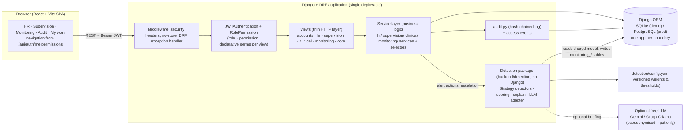
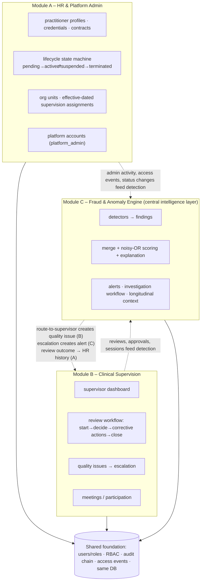
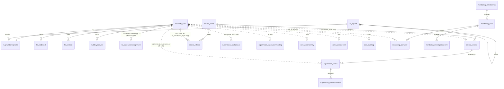
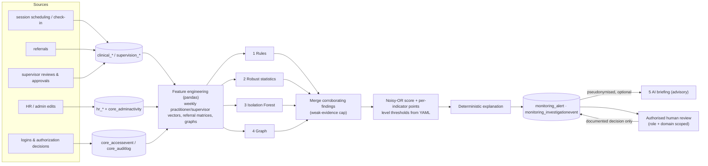
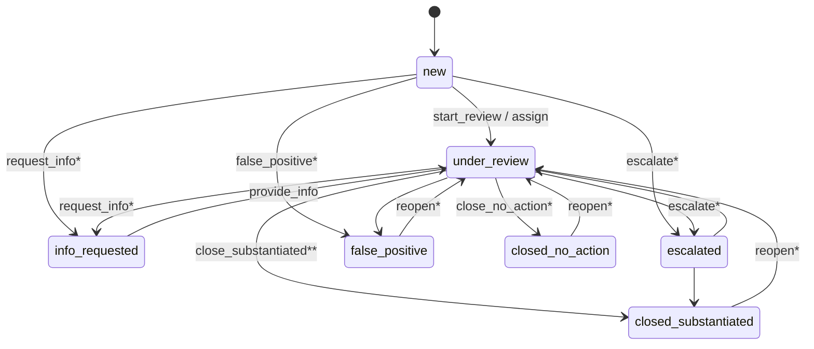

# معماری و طراحی

[English](../ARCHITECTURE.md) · **فارسی**

همه‌ی نمودارها Mermaid هستند (در GitHub / VS Code به‌صورت بومی نمایش داده می‌شوند؛ برچسب‌های داخل نمودارها عمداً انگلیسی مانده‌اند چون نام فایل‌ها و جدول‌ها هستند). فایل‌های همراه: [UNDERSTANDING.md](UNDERSTANDING.md) (اول این را بخوانید)، [RBAC_MATRIX.md](../RBAC_MATRIX.md)، [openapi.yaml](../openapi.yaml) / آدرس زنده‌ی `/api/docs/`، [DATASET.md](DATASET.md)، [TECHNICAL_REPORT.md](TECHNICAL_REPORT.md).

## ۱. معماری سیستم

**چرا یک واحدِ استقرار؟** صورت‌مسئله یک نمونه‌ی اولیه می‌خواهد که سه ماژول روی یک مدل داده‌ی منسجم به اشتراک بگذارند. مونولیت ماژولار (یک اپ Django برای هر مرز، یک پایگاه‌داده) این را با کمترین قطعه‌ی متحرک فراهم می‌کند؛ مرزها طوری کشیده شده‌اند که هر بسته بعداً قابل جداسازی باشد (ر.ک. §۹).

## ۲. معماری ماژول‌ها و سرویس‌ها

**نقاط یکپارچگی که *پیاده‌سازی شده‌اند* (نه فقط توصیف):**

| جریان | سازوکار |
|---|---|
| فعالیت غیرعادی متخصص ← هشدار | `clinical_session` / `supervision_review` / `clinical_referral` ← موتور ← `monitoring_alert` |
| HR / انطباق هشدار را بررسی می‌کند | `GET /alerts/{id}` (محدود به نقش، ارجاع‌های مراجع پنهان) |
| نگرانی کیفیت ← سوپروایزر درست | `POST /alerts/{id}/route-to-supervisor` ← `supervision_qualityissue` برای سوپروایزر *فعلی* (هرگز وقتی خودِ سوپروایزر در هشدار دخیل است) |
| نتیجه‌ی بازبینی سوپروایزر ← پرونده‌ی عملیاتی | `decide_review` یک خلاصه در `hr_lifecycleevent(supervision_review)` می‌نویسد – هیچ محتوای بالینی از مرز عبور نمی‌کند |
| ارجاع سوپروایزر ← پایش | `escalate_issue` یک ردیف `monitoring_alert` می‌سازد (دسته‌ی Q، شاخص دستی) |
| ناهنجاری‌های تکرارشونده ← پایش طولی بدون پیش‌داوری | `GET /monitoring/users/{id}/history` – فقط زمینه؛ هرگز امتیاز یا وضعیت را تغییر نمی‌دهد |

## ۳. طراحی پایگاه‌داده

۲۱ جدول؛ **مرزها همان اپ‌های Django هستند** (`accounts`+`hr` هویت/نیروی کار، `clinical`+`supervision` عملیات مراقبت، `core` امنیت، `monitoring` خروجی هوش مصنوعی). ارجاع‌های بین‌مرزی به افراد **شناسه‌ی صرفِ عددی (نه کلید خارجی)** هستند (مراجعان شبه‌ناشناس‌اند)؛ همین کار امکان انتقال جداول بالینی به پایگاه‌داده/خوشه‌ی جدا با اعتبارنامه‌ی جدا را می‌دهد (ر.ک. §۹).

ستون‌های کلیدی (تعریف کامل: `models.py` هر اپ؛ مهاجرت‌ها: پوشه‌ی `migrations/` هر اپ):

| جدول | توضیح |
|---|---|
| `accounts_user` | نقش، وضعیت (`pending_onboarding/active/suspended/terminated`)، شمارنده‌های قفل حساب؛ هش PBKDF2 |
| `hr_supervisionassignment` | `effective_from/effective_to` – **تاریخچه هرگز بازنویسی نمی‌شود**؛ ایندکس `(supervisee_id, effective_to)` انتساب فعلی را پیدا می‌کند |
| `hr_lifecycleevent` | «تاریخچه‌ی کامل فعالیت و وضعیت» (جذب، تعلیق، تغییر انتساب، خلاصه‌ی نتیجه‌ی بازبینی) |
| `clinical_session` | زمان‌بندی‌شده در برابر گزارش‌شده در برابر راستی‌آزمایی‌شده (`checkin_at/checkout_at`)، `modification_count`، `group_id` (جلسات گروهیِ مشروع)، `mode/location_code` |
| `supervision_review` | `decision_minutes`، `has_documentation` (ویژگی‌های رفتار تأیید)، `closed_at` |
| `core_auditlog` | زنجیره‌ی `prev_hash`/`hash`؛ `GET /api/audit/verify` آن را دوباره محاسبه می‌کند |
| `core_accessevent` | ورود موفق/ناموفق، دسترسی مجاز/ردشده با permission + path + IP |
| `monitoring_alert` | امتیاز، سطح، `methods[]`، `score_breakdown` (JSON، مجموع امتیازها = امتیاز)، `evidence`، `record_refs`، `ruleset_version`، `model_version`، `dedup_key` |

**ایندکس‌گذاری** (همه روی مسیرهای پرتردد): `clinical_session(practitioner_id, scheduled_start)`، `clinical_referral(from_user_id)`، `clinical_referral(to_practitioner_id)`، `supervision_review(supervisor_id|supervisee_id|decided_at)`، `core_accessevent(ts,user_id)`، `core_auditlog(ts,actor_id)`، `monitoring_alert(status, risk_level, category, domain, subject_user_id, dedup_key, detected_at)`.

**مرزهای مالکیت داده**

| اپ (جدول‌ها) | مالک | چه کسی می‌تواند بخواند |
|---|---|---|
| `accounts_*`، `hr_*` | مدیریت منابع انسانی | hr_admin (خواندن/نوشتن)، انطباق (فقط‌خواندنی)، سوپروایزرها (فقط *خلاصه‌ی* زیردستان خود) |
| `clinical_*`، `supervision_*` | عملیات بالینی | درمانگر (خودش)، سوپروایزر (زیردستان فعلی)، انطباق (کاربران موجود در هشدار). **هرگز** hr_admin / platform_admin |
| `core_*` | امنیت و حسابرسی | انطباق، platform_admin (audit:read) |
| `monitoring_*` | انطباق و پایش | دید بر اساس نقش←حوزه، هرگز موضوع هشدار |

**تاریخچه‌ی حسابرسی و نگهداشت.** ردیف‌های audit/access/alert/investigation فقط‌افزودنی‌اند (API هیچ update/delete ارائه نمی‌دهد). نگهداشت پیشنهادی برای تولید (تصمیم سیاستی، نه اعمال‌شده در نمونه‌ی اولیه): حسابرسی و تحقیق ۷ سال؛ رویدادهای دسترسی ۲۴ ماه؛ ویژگی‌های رفتاری خام ۱۳ ماهِ غلتان؛ فراداده‌ی جلسات بالینی طبق قانون مدارک بالینی؛ هشدارهای بسته‌شده به‌عنوان مثبت کاذب ۲۴ ماه (برای تنظیم آستانه‌ها لازم است). شناسه‌های شبه‌ناشناس مراجع اجازه می‌دهند جدول نگاشت بدون شکستن تجمیع‌ها پاک شود.

## ۴. جریان داده

## ۵. معماری تشخیص تقلب (روش ← چرا)

| # | لایه | کاربرد | چرا این روش |
|---|---|---|---|
| ۱ | **قواعد (Rules)** | جلسات هم‌پوشان/ناممکن (جاروی بازه‌ها)، مدت گزارش‌شده در برابر راستی‌آزمایی‌شده، تأیید بدون مستندات / بازبینی زیر ۳ دقیقه، انفجار دسترسی ردشده، انفجار ورود ناموفق، انفجار ساخت حساب، اعطای دسترسی ویژه، انفجار ویرایش | ناممکن‌های منطقی و نقض سیاست به آمار نیاز ندارند؛ دقیق، ارزان، ۱۰۰٪ قابل‌توضیح و بدون نیاز به برچسب |
| ۲ | **آمار مقاوم** | تمرکز ارجاع (آزمون نیکویی برازش مونت‌کارلوی آگاه از سیاست + فاصله‌ی JS + مقایسه با خط‌پایه‌ی ساده)؛ پرت‌های همتا (z-score بر پایه‌ی میانه/MAD) | تعداد کم برای هر متخصص ⇒ کای‌دوی مجانبی قابل‌اعتماد نیست، پس از توزیع صفر شبیه‌سازی‌شده استفاده می‌شود؛ MAD در برابر همان پرت‌هایی که شکار می‌شوند مقاوم است؛ انتظار آگاه از سیاست، تخصص را از جهت‌دهیِ مشکوک جدا می‌کند |
| ۳ | **Isolation Forest** (برای هر هم‌گروه نقش، بردارهای متخصص-هفته) | ناشناخته‌های ناشناخته: عجایب چندمتغیره که هیچ قاعده‌ای پیش‌بینی نکرده | بدون ناظر (سابقه‌ی تقلب برچسب‌دار وجود ندارد)، مقیاس‌های مختلط، سریع. همیشه با ویژگی‌های محرک z مقاوم *توضیح داده می‌شود*؛ پرچم‌های غیرقابل‌توضیح حذف می‌شوند؛ وزن ضعیف؛ به‌تنهایی نمی‌تواند از **Low** فراتر رود |
| ۴ | **گراف** (networkx) | یال‌های ارجاع مشاور←درمانگر + یال‌های تأیید سوپروایزر←درمانگر؛ درمانگرانی را علامت می‌زند که **هم** وابستگی انحصاری ارجاع (lift سیاست ≥۲×) **و هم** یال تأیید بی‌قیدوشرط دارند | تبانی یک ویژگیِ *رابطه‌ای* است – برای آزمون‌های تک‌کاربره نامرئی. فقط جایی توجیه دارد که روابط حامل سیگنال‌اند |
| ۵ | **تحقیق به کمک هوش مصنوعی** | خلاصه‌ی توصیه‌ای کوتاه از یک هشدار (LLM رایگان، یا قالب قطعی بدون اینترنت) | LLM هرگز امتیاز نمی‌دهد یا تصمیم نمی‌گیرد؛ ورودی شواهد ساختاریافته‌ی شبه‌ناشناس است؛ خروجی جدا ذخیره و «توصیه‌ای» برچسب می‌خورد |

**امتیازدهی ریسک** (`backend/detection/scoring.py`، وزن‌ها در `backend/detection/config.yaml`):

`score = 100 · (1 − Π(1 − wᵢ·sᵢ))` — هر شاخص یک وزن `w` (حداکثر سهم) و یک قدرتِ اندازه‌گیری‌شده `s ∈ [0,1]` دارد. امتیازها به‌ترتیب نسبت داده می‌شوند تا **Σ امتیازها دقیقاً برابر امتیاز کل** باشد؛ رابط کاربری جدول را نشان می‌دهد. سطح‌ها: Low ‏۰–۳۴، Medium ‏۳۵–۵۹، High ‏۶۰–۷۹، Critical ‏≥۸۰. **قاعده‌ی تأیید متقابل:** هشدارهایی که فقط به شاخص‌های ضعیف (امتیاز ML، حجم کاری) تکیه دارند در سطح Low سقف می‌خورند – حجم یا یک امتیاز مدلِ مبهم به‌تنهایی هرگز یافته‌ی جدی به نظر نمی‌رسد.

**مدیریت مثبت کاذب:** (الف) انتظارات آگاه از سیاست و رفتار با جلسات گروهی الگوهای بی‌خطر شناخته‌شده را حذف می‌کنند؛ (ب) نامزدهای *سرکوب‌شده* با دلیل فهرست می‌شوند؛ (پ) هشدار بسته‌شده دوباره مطرح نمی‌شود مگر **رکوردهای جدید** (`record_refs`) داشته باشد؛ (ت) نتیجه‌ی مثبت کاذب برای هر سناریو تجمیع می‌شود (`/monitoring/summary`) تا آستانه‌ها تنظیم شوند؛ (ث) هر هشدار توضیحات بی‌خطرِ قابل‌بررسی را فهرست می‌کند.

**نسخه‌بندی:** `ruleset_version` (YAML)، `model_version` (هش ویژگی‌ها/پارامترها/دانه)، `config_hash` برای هر اجرای تشخیص – روی هر هشدار و اجرا ذخیره می‌شود ⇒ نتایج بازتولیدپذیرند.

## ۶. گردش‌کار تحقیق (ماشین حالت)

`*` یادداشت مستند لازم است (≥۱۰ نویسه). `**` یادداشت ≥۳۰ نویسه **و** بازبینِ بسته‌کننده باید شواهد را دیده باشد (به‌صورت رویداد `viewed` ثبت می‌شود). هیچ گذاری اثر جانبی روی وضعیت، نقش، قرارداد یا انتساب متخصص ندارد – آن‌ها اقدام‌های جداگانه‌ی انسانیِ HR هستند (`POST /hr/.../lifecycle`). یک تست تضمین می‌کند موتور هرگز `accounts_user` را تغییر نمی‌دهد.

## ۷. طراحی امنیت و حریم خصوصی

| دغدغه | پیاده‌سازی |
|---|---|
| احراز هویت | هشر PBKDF2-SHA256 جنگو (نمک مخصوص هر کاربر)؛ JWT از نوع HS256 (۶۰ دقیقه)؛ 401 یکنواخت (بدون شمارش حساب‌ها)؛ قفل پس از ۵ شکست (پاسخ 403)؛ توکن کاربران تعلیق‌شده فوراً از کار می‌افتد (کاربر در هر درخواست دوباره بارگذاری می‌شود) |
| مجوزدهی / حداقل امتیاز | ماتریس مرکزی `core/rbac.py` + `core/permissions.py` + محدودسازی بر پایه‌ی رابطه (`monitoring/visibility.py`، `hr/selectors.py`) (خود / زیردست فعلی / موضوع هشدار). HR و مدیران پلتفرم **هیچ** مجوز بالینی ندارند. ردها هم 403 هستند **و هم** ذخیره می‌شوند (`core_accessevent` + audit) – این همان سیگنال سناریوی ۴ است |
| حفاظ تعارض منافع | هیچ‌کس نمی‌تواند هشداری درباره‌ی خودش یا هشداری که در آن کاربر مرتبط است را ببیند/واگذار/ارجاع کند؛ هشداری که سوپروایزر در آن دخیل است هرگز به او ارجاع نمی‌شود؛ هشدارهای حوزه‌ی تخلف هرگز به سوپروایزرها ارجاع نمی‌شوند |
| حفاظت از داده‌ی حساس | فقط **شناسه‌ی شبه‌ناشناس** مراجع؛ هیچ روایت آزاد بالینی ذخیره نمی‌شود؛ `client_ref` برای نقش‌های بدون دسترسی بالینی پنهان می‌شود؛ نماهای HR هیچ فیلد بالینی ندارند؛ فهرست مراجعِ درمانگر به پرونده‌ی خودش محدود است |
| کمینه‌سازی داده | پرامپت LLM نام/ایمیل/شناسه‌ی مراجع ندارد («Practitioner #12»)؛ ویژگی‌ها تجمیعی‌اند؛ نمای کلی زیردست فقط *تعداد* جلسات را برمی‌گرداند؛ فهرست تفصیلی جلسات (زمان/وضعیت/شناسه‌ی شبه‌ناشناس، بدون روایت) محدود به رابطه و حسابرسی‌شده است |
| ثبت حسابرسی | زنجیره‌ی هش (`/audit/verify` دست‌کاری را تشخیص می‌دهد – تست‌شده)؛ *چه چیزی دیده شد* (دسته‌ی فیلدها) را ثبت می‌کند، نه خود داده را |
| ارتباط امن API | اعتبارسنجی serializer در DRF در همه‌جا؛ توکن‌های bearer؛ هدرهای امنیتی (`nosniff`، `X-Frame-Options: DENY`، CSP، `no-store` روی مسیرهای حساس)؛ TLS در reverse proxy پایان می‌یابد (مستند، نه درون برنامه) |
| اسرار | فقط متغیر محیطی (`.env` در git نادیده گرفته می‌شود، `.env.example` ارائه شده)؛ هیچ رازی در کد نیست؛ کلید مخفی باید عوض شود (مستند) |
| آسیب‌پذیری‌های رایج | تزریق SQL: فقط ORM/پارامتری؛ XSS: React همه‌ی داده‌ی نمایش‌داده‌شده را escape می‌کند (بدون `dangerouslySetInnerHTML`)، CSP با `default-src 'self'`؛ IDOR: هر دسترسی به شیء رابطه را بررسی می‌کند؛ mass assignment: schemaهای صریح درخواست؛ نشت خطا: بدنه‌ی 500 عمومی و جزئیات در لاگ؛ ارتقای امتیاز: تغییر نقش خود مسدود و حسابرسی می‌شود؛ brute force: قفل حساب |
| داده‌ی واقعی | هیچ – فقط مولد مصنوعی؛ رمز دمو صرفاً دمو معرفی شده |

## ۸. معماری API

REST/JSON، منبع‌محور، نسخه‌پذیر با پیشوند؛ view نازک ← service ← model. خطاها: `400` اعتبارسنجی، `404`، `409` تعارض (گذار وضعیت غیرمجاز / تکراری)، `401/403` احراز هویت (قفل حساب 403 برمی‌گرداند). OpenAPI تولیدشده: [openapi.yaml](../openapi.yaml)، رابط زنده‌ی Swagger در `/api/docs/`. صفحه‌بندی در نقاط پایانی فهرست (`limit/offset`). `POST /detection/run` ناپذیرای اثر تکراری (idempotent) است (حذف تکرار با `dedup_key`).

## ۹. یکپارچگی با پلتفرم موجود آرامانا (Go)

* **اتصال قرارداد-محور.** هسته‌ی Go از طریق قرارداد REST/OpenAPI (یا رویدادها، پایین‌تر) با این سرویس صحبت می‌کند. بدون جدول مشترک، بدون منطق کسب‌وکار تکراری: داده‌ی HR/نظارت مالکِ ماژول است؛ Go *رکوردهای هویت و مراجعِ* مرجع را نگه می‌دارد.
* **هویت:** صدور JWT را با OIDC/SSO هسته عوض کنید؛ `core/rbac.py` نقش/claimها را مصرف می‌کند – بدون تغییر. `accounts_user` به یک projection با کلیدِ شناسه‌ی کاربر هسته تبدیل می‌شود.
* **رویدادمحوری:** هسته رویدادهای `session.*`، `referral.*`، `review.*`، `auth.*`، `admin.*` را منتشر می‌کند (outbox ← صف)؛ یک ingester نازک آن‌ها را به ردیف‌های `clinical_*`/`supervision_*`/`core_*` نگاشت می‌کند. موتور تشخیص فقط همین جداول را می‌خواند، پس مستقل از منبع است.
* **جداسازی سرویس هوش مصنوعی:** `backend/detection` از قبل وابستگی به فریمورک ندارد (توابع خالص روی DataFrame). می‌تواند به‌صورت worker جدا و زمان‌بندی‌شده (مثلاً هر ۱۵ دقیقه) مستقر شود، در حالی که هسته‌ی Go نقاط `/alerts` و `/monitoring/*` را صدا می‌زند.
* **مرز داده:** اپ‌های `clinical`/`supervision` را به یک پایگاه‌داده/نقش Postgres جدا وصل کنید (database routerهای Django) تا جداسازی بالینی/اداری به‌صورت فیزیکی اعمال شود.

## ۱۰. راهبرد مقیاس‌پذیری

| گام مقیاس | تغییر |
|---|---|
| ۱۰× کاربر | Postgres + connection pooling؛ schema/ایندکس‌ها از قبل برای شرط‌های پرتردد طراحی شده‌اند |
| هزینه‌ی تشخیص | ویژگی‌ها برای هر بازه محاسبه می‌شوند؛ به نماهای مادی‌سازی‌شده‌ی افزایشی (تجمیع هفتگی) بروید و آشکارسازها را برای هر هم‌گروه در workerهای موازی اجرا کنید؛ آزمون مونت‌کارلو برداری‌شده است (`4000×n×T`) و فقط برای مشاورانِ با ≥۲۰ ارجاع اجرا می‌شود |
| دید هشدار | نمونه‌ی اولیه دید را پس از یک فیلتر SQL در سطح حوزه، در پایتون فیلتر می‌کند؛ تولید: امنیت سطح ردیف (RLS) / شرط‌های SQL + صفحه‌بندی keyset |
| LLM | اختیاری، ناهمگام، با نرخ محدود؛ برای جریان‌های اصلی هیچ وابستگی ندارد |
